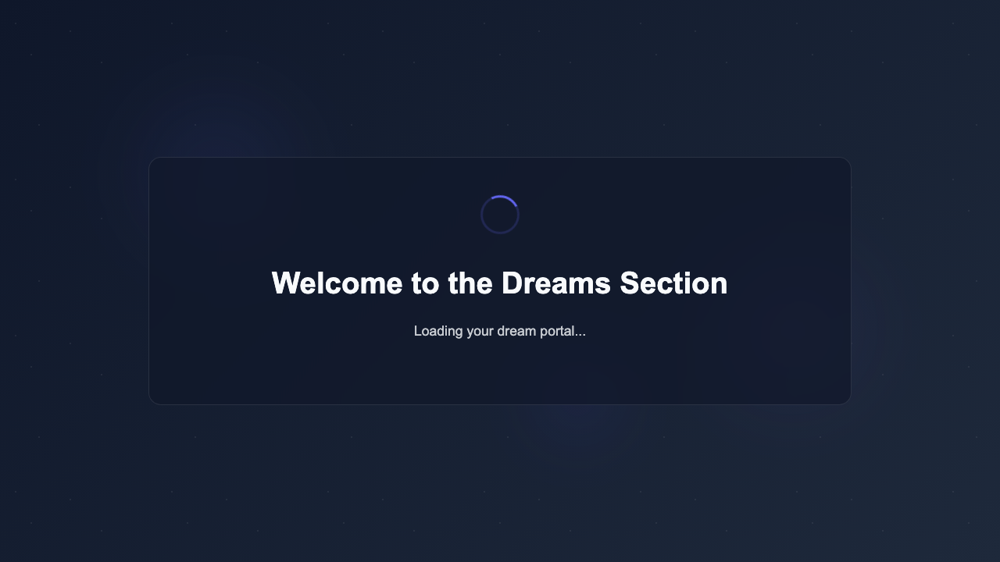
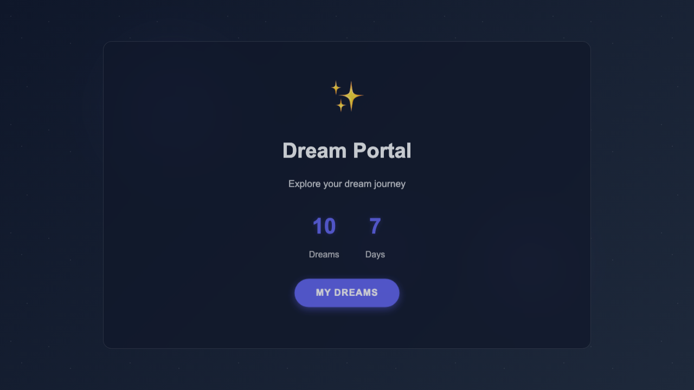
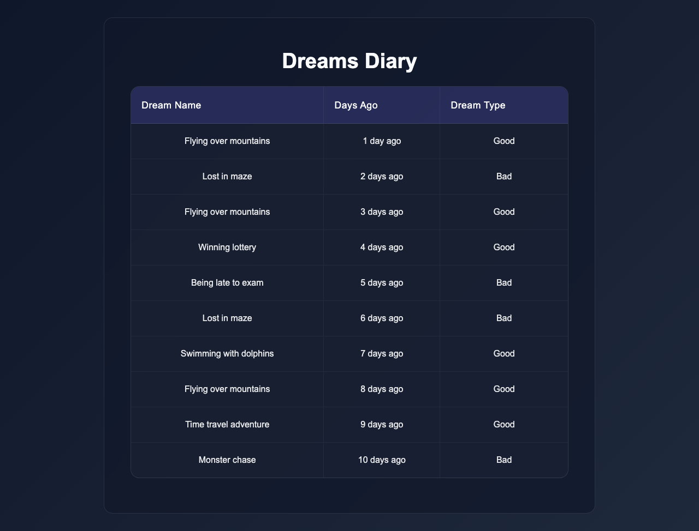
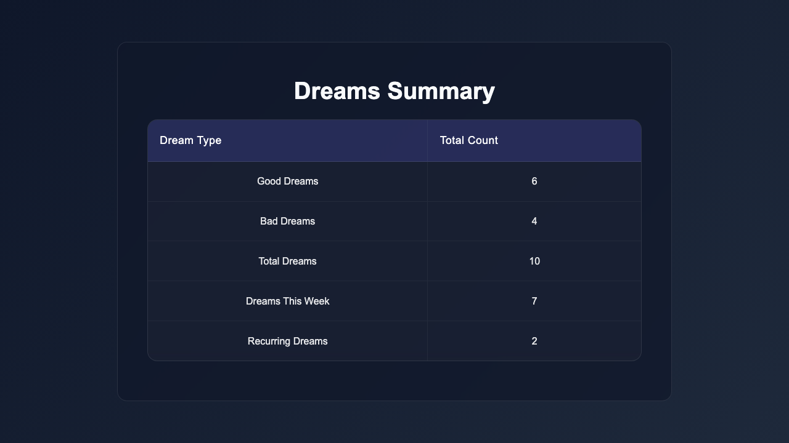
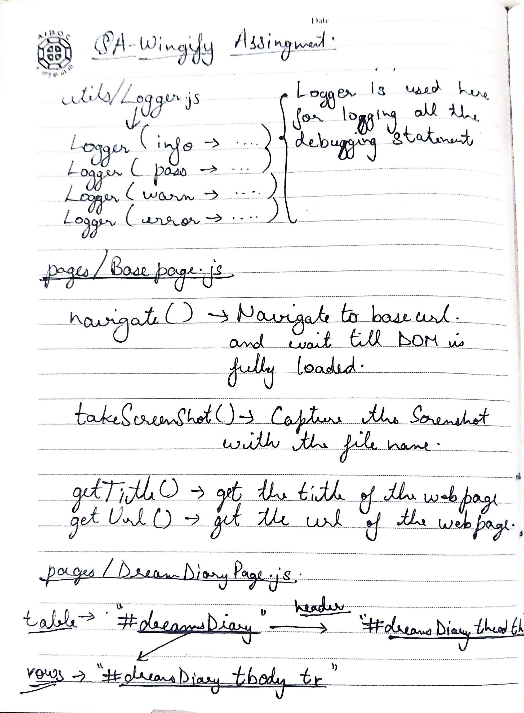
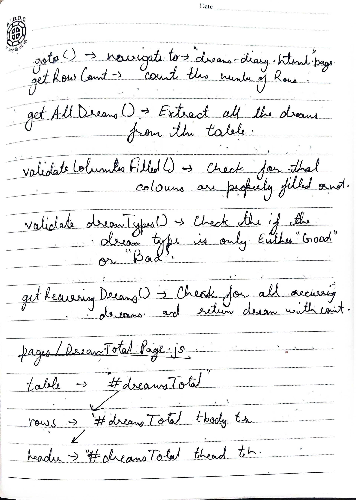
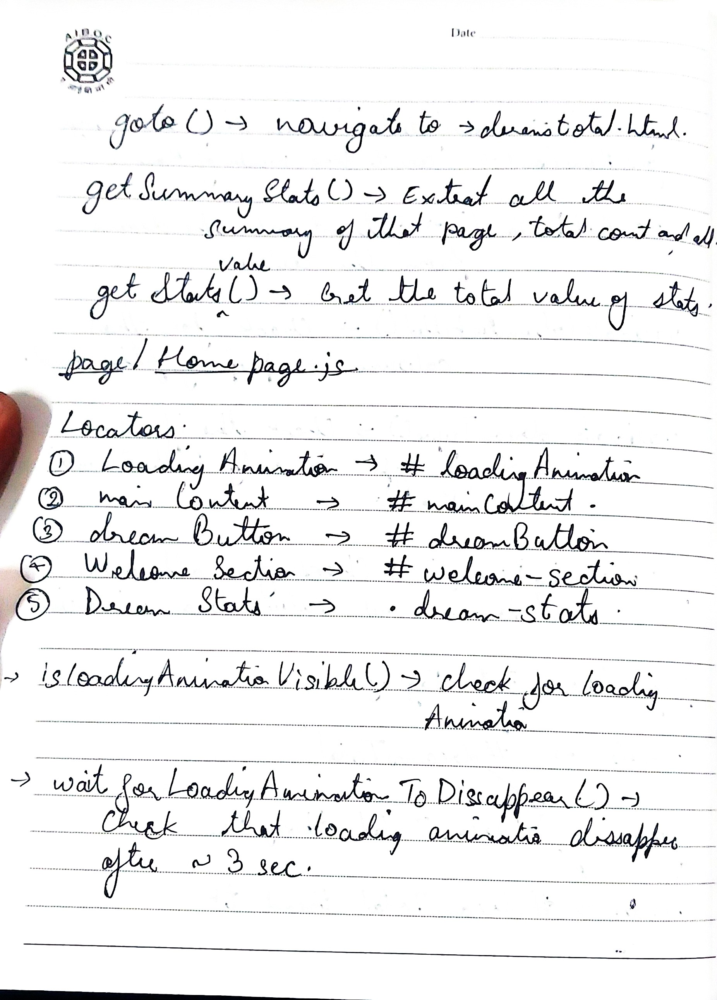
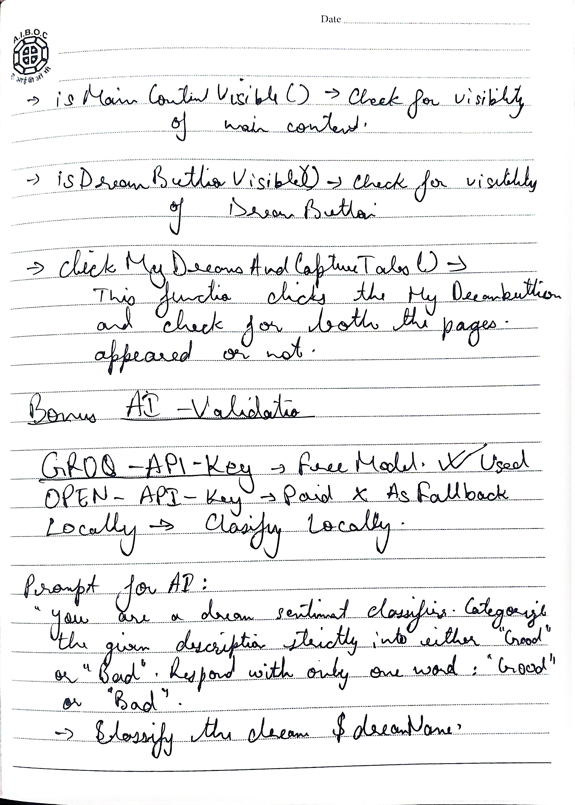
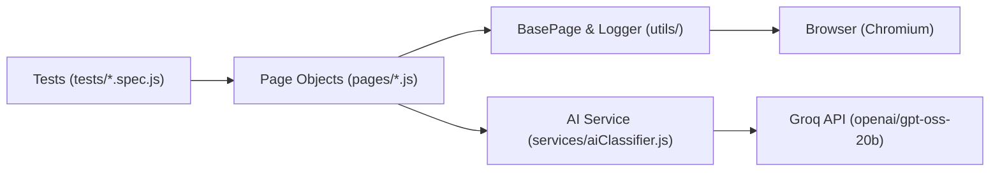

# 🌌 Dream Portal — Automated Test Suite

[](https://playwright.dev/)
[](https://developer.mozilla.org/)
[](https://groq.com/)

Automated QA testing framework for the [Dream Portal](https://arjitnigam.github.io/myDreams/) web application using **Playwright (JavaScript)** with **Page Object Model (POM)** and **Groq AI (openai/gpt-oss-20b)** for dream sentiment classification.

---

## 🚀 Quick Start

```bash
# 1. Install dependencies
npm install

# 2. Install Playwright browser
npx playwright install chromium

# 3. Configure environment
cp .env.example .env
# (Optional) Add your GROQ_API_KEY in .env

# 4. Run all tests
npm test
```

### Available Test Commands

| Command | Purpose |
| :--- | :--- |
| `npm test` | Run all 11 tests across 5 test specs headlessly |
| `npm run test:headed` | Run tests with visible browser window |
| `npm run test:ui` | Open interactive Playwright UI runner |
| `npm run test:ai` | Run only Part 2 AI classification validation |
| `npm run test:report` | Open HTML test execution report |

---

## 📸 Test Execution, Screenshots & Terminal Logs

### 1. Home Page — Loading Animation & Navigation (`index.html`)

**Brief Description**:
- **Loader Timing**: Verifies that `#loadingAnimation` is immediately visible upon landing and automatically disappears after ~3 seconds ($2.5s \le t \le 5.0s$).
- **Content & Button Reveal**: Confirms `#mainContent` and the `"My Dreams"` button become visible with `.show` CSS animation classes.
- **Multi-Tab Spawning**: Asserts that clicking `"My Dreams"` triggers and captures both `dreams-diary.html` and `dreams-total.html` in separate concurrent browser tabs.

| Initial Loading State (~3s) | Content & Button Revealed |
| :---: | :---: |
|  |  |

#### 🖥️ Terminal Execution Logs (`tests/home.spec.js`):
```text
$ npx playwright test tests/home.spec.js

Running 3 tests using 3 workers

[INFO] [2026-09-23T06:49:57.009Z] Navigating to: index.html
[INFO] [2026-09-23T06:49:57.910Z] Starting test: verify new tabs opening on "My Dreams" click
[INFO] [2026-09-23T06:49:57.910Z] Waiting for loading animation to disappear...
[INFO] [2026-09-23T06:49:57.911Z] Starting test: verify loading animation behavior
[INFO] [2026-09-23T06:49:57.911Z] Starting test: verify main content & "My Dreams" button visibility
[INFO] [2026-09-23T06:49:57.911Z] Waiting for loading animation to disappear...
[INFO] [2026-09-23T06:49:58.027Z] Loading animation initial visibility: true
[INFO] [2026-09-23T06:49:58.060Z] Waiting for loading animation to disappear...
[PASS] [2026-09-23T06:50:00.872Z] Loading animation disappeared.
[PASS] [2026-09-23T06:50:00.887Z] Loading animation disappeared.
[INFO] [2026-09-23T06:50:00.887Z] Loading animation disappeared in 2.83 seconds
[INFO] [2026-09-23T06:50:00.898Z] Capturing screenshot: home-after-loading
[PASS] [2026-09-23T06:50:00.900Z] Loading animation disappeared.
[INFO] [2026-09-23T06:50:00.901Z] Clicking "My Dreams" button and awaiting opened tabs...
[INFO] [2026-09-23T06:50:00.914Z] Capturing screenshot: home-main-content-visible
  ✓ should verify main content and "My Dreams" button become visible after loading (4.4s)
  ✓ should verify loading animation appears and disappears after ~3 seconds (4.4s)
[PASS] [2026-09-23T06:50:02.207Z] Successfully captured 2 new tabs.
[INFO] [2026-09-23T06:50:02.209Z] Opened tabs URLs: https://arjitnigam.github.io/myDreams/dreams-diary.html | https://arjitnigam.github.io/myDreams/dreams-total.html
  ✓ should open dreams-diary.html and dreams-total.html in new tabs upon clicking "My Dreams" (5.7s)

  3 passed (6.3s)
```

---

### 2. Dreams Diary — Data Integrity (`dreams-diary.html`)

**Brief Description**:
- **Row Count**: Scrapes the `#dreamsDiary` table and asserts that there are exactly **10 dream entries**.
- **Type Constraints**: Validates that all entries in the `Dream Type` column are strictly either `"Good"` or `"Bad"`.
- **Cell Completeness**: Iterates every row to ensure all three columns (`Dream Name`, `Days Ago`, and `Dream Type`) contain non-empty strings.



#### 🖥️ Terminal Execution Logs (`tests/diary.spec.js`):
```text
$ npx playwright test tests/diary.spec.js

Running 3 tests using 3 workers

[INFO] [2026-09-23T06:50:10.326Z] Navigating to: dreams-diary.html
[INFO] [2026-09-23T06:50:10.546Z] Starting test: validate all 3 columns are filled per row
[INFO] [2026-09-23T06:50:10.590Z] Starting test: validate dream types strictly "Good" or "Bad"
[INFO] [2026-09-23T06:50:10.590Z] Starting test: validate dream entries count
[INFO] [2026-09-23T06:50:10.625Z] Found 10 dream rows in table.
[INFO] [2026-09-23T06:50:10.635Z] Capturing screenshot: diary-10-entries
[INFO] [2026-09-23T06:50:10.660Z] Parsed 10 dream records from diary table.
[INFO] [2026-09-23T06:50:10.697Z] Parsed 10 dream records from diary table.
[INFO] [2026-09-23T06:50:10.712Z] Parsed 10 dream records from diary table.
  ✓ should validate that each row has all three columns filled (630ms)
  ✓ should validate that dream types are strictly "Good" or "Bad" (633ms)
  ✓ should validate that there are exactly 10 dream entries (736ms)

  3 passed (1.2s)
```

---

### 3. Dreams Total — Summary Stats & Cross-Page Logic (`dreams-total.html`)

**Brief Description**:
- **Statistics Verification**: Parses key-value rows from `#dreamsTotal` and verifies counts: `Good Dreams: 6`, `Bad Dreams: 4`, `Total Dreams: 10`, and `Recurring Dreams: 2`.
- **Dynamic Cross-Page Logic**: Queries data from `dreams-diary.html`, computes an algorithmic frequency map for occurrences $> 1$, and asserts that `"Flying over mountains"` (3 appearances) and `"Lost in maze"` (2 appearances) are counted as recurring dreams matching the summary page.



#### 🖥️ Terminal Execution Logs (`tests/summary.spec.js`):
```text
$ npx playwright test tests/summary.spec.js

Running 2 tests using 2 workers

[INFO] [2026-09-23T06:50:17.669Z] Navigating to: dreams-total.html
[INFO] [2026-09-23T06:50:17.907Z] Starting test: verify summary statistics values
[INFO] [2026-09-23T06:50:17.924Z] Starting cross-page validation: recurring dreams calculation from diary
[INFO] [2026-09-23T06:50:17.958Z] Extracted summary statistics: {"Good Dreams":6,"Bad Dreams":4,"Total Dreams":10,"Dreams This Week":7,"Recurring Dreams":2}
[INFO] [2026-09-23T06:50:17.958Z] Captured stats from UI: {"Good Dreams":6,"Bad Dreams":4,"Total Dreams":10,"Dreams This Week":7,"Recurring Dreams":2}
[INFO] [2026-09-23T06:50:17.963Z] Capturing screenshot: summary-stats-verified
[INFO] [2026-09-23T06:50:17.974Z] Navigating to: dreams-diary.html
  ✓ should verify correct stats displayed on summary page (546ms)
[INFO] [2026-09-23T06:50:18.222Z] Parsed 10 dream records from diary table.
[INFO] [2026-09-23T06:50:18.222Z] Identified 2 recurring dreams: Flying over mountains, Lost in maze
[INFO] [2026-09-23T06:50:18.222Z] Frequency map computed from diary: {"Flying over mountains":3,"Lost in maze":2,"Winning lottery":1,"Being late to exam":1,"Swimming with dolphins":1,"Time travel adventure":1,"Monster chase":1}
[INFO] [2026-09-23T06:50:18.222Z] Recurring dreams computed: [ 'Flying over mountains', 'Lost in maze' ]
[INFO] [2026-09-23T06:50:18.248Z] Extracted summary statistics: {"Good Dreams":6,"Bad Dreams":4,"Total Dreams":10,"Dreams This Week":7,"Recurring Dreams":2}
  ✓ should assert "Flying over mountains" and "Lost in maze" are counted as recurring (846ms)

  2 passed (1.2s)
```

---

### 4. Part 2: Bonus AI Validation (Groq LLM) (`tests/ai-validation.spec.js`)

**Brief Description**:
- **Model**: Groq API with `openai/gpt-oss-20b` (with deterministic heuristic fallback for offline/CI environments).
- **Target Example Assertion**: Classifies `"Monster chase"` $\rightarrow$ `"Bad"`.
- **Dynamic Table Classification**: Extracts all 10 dream names from the Diary table, sends each to the LLM with a 300-token budget for reasoning chains, and validates predictions against table values.
- **Accuracy**: **100% Match Rate (10/10)**.

#### 🖥️ Terminal Execution Logs & AI Validation Matrix:
```text
$ npx playwright test tests/ai-validation.spec.js

[INFO] [2026-09-23T06:50:44.388Z] AI Classifier initialized. Provider: groq, Model: openai/gpt-oss-20b

Running 2 tests using 2 workers

[INFO] [2026-09-23T06:50:45.053Z] Starting table-wide AI validation and comparison against UI table types
[INFO] [2026-09-23T06:50:45.098Z] Starting AI classification test for specific PDF example: "Monster chase"
[INFO] [2026-09-23T06:50:45.098Z] [GROQ Classifier] Requesting classification for "Monster chase" using openai/gpt-oss-20b...
[INFO] [2026-09-23T06:50:45.118Z] Parsed 10 dream records from diary table.
[PASS] [2026-09-23T06:50:45.546Z] [GROQ Classifier] "Monster chase" -> Bad
[INFO] [2026-09-23T06:50:45.546Z] Classification for "Monster chase": Bad (Engine: groq)
  ✓ should validate the assignment example: "Monster chase" is classified as "Bad" (972ms)
[PASS] [2026-09-23T06:50:45.586Z] [GROQ Classifier] "Flying over mountains" -> Good
[PASS] [2026-09-23T06:50:45.822Z] [GROQ Classifier] "Lost in maze" -> Bad
[PASS] [2026-09-23T06:50:46.348Z] [GROQ Classifier] "Flying over mountains" -> Good
[PASS] [2026-09-23T06:50:46.786Z] [GROQ Classifier] "Winning lottery" -> Good
[PASS] [2026-09-23T06:50:47.220Z] [GROQ Classifier] "Being late to exam" -> Bad
[PASS] [2026-09-23T06:50:47.617Z] [GROQ Classifier] "Lost in maze" -> Bad
[PASS] [2026-09-23T06:50:48.099Z] [GROQ Classifier] "Swimming with dolphins" -> Good
[PASS] [2026-09-23T06:50:48.713Z] [GROQ Classifier] "Flying over mountains" -> Good
[PASS] [2026-09-23T06:50:49.231Z] [GROQ Classifier] "Time travel adventure" -> Good
[PASS] [2026-09-23T06:50:49.710Z] [GROQ Classifier] "Monster chase" -> Bad

=================== AI VALIDATION REPORT ===================
┌─────────┬──────────────────────────┬─────────────┬───────────────┬──────────┬────────┐
│ (index) │ Dream Name               │ Table Value │ AI Prediction │ Match?   │ Engine │
├─────────┼──────────────────────────┼─────────────┼───────────────┼──────────┼────────┤
│ 0       │ 'Flying over mountains'  │ 'Good'      │ 'Good'        │ '✅ YES' │ 'groq' │
│ 1       │ 'Lost in maze'           │ 'Bad'       │ 'Bad'         │ '✅ YES' │ 'groq' │
│ 2       │ 'Flying over mountains'  │ 'Good'      │ 'Good'        │ '✅ YES' │ 'groq' │
│ 3       │ 'Winning lottery'        │ 'Good'      │ 'Good'        │ '✅ YES' │ 'groq' │
│ 4       │ 'Being late to exam'     │ 'Bad'       │ 'Bad'         │ '✅ YES' │ 'groq' │
│ 5       │ 'Lost in maze'           │ 'Bad'       │ 'Bad'         │ '✅ YES' │ 'groq' │
│ 6       │ 'Swimming with dolphins' │ 'Good'      │ 'Good'        │ '✅ YES' │ 'groq' │
│ 7       │ 'Flying over mountains'  │ 'Good'      │ 'Good'        │ '✅ YES' │ 'groq' │
│ 8       │ 'Time travel adventure'  │ 'Good'      │ 'Good'        │ '✅ YES' │ 'groq' │
│ 9       │ 'Monster chase'          │ 'Bad'       │ 'Bad'         │ '✅ YES' │ 'groq' │
└─────────┴──────────────────────────┴─────────────┴───────────────┴──────────┴────────┘
============================================================

[PASS] AI Classification vs Table Match Rate: 100.0% (10/10)
  ✓ should retrieve all dream names, classify with AI, and compare with table data (5.3s)

  2 passed (5.7s)
```

---

## 📝 Design Blueprint & Engineering Notes

The architecture, class designs, locators, and AI prompt engineering were systematically mapped prior to implementation:

| Sheet 1: Core Foundation & Diary Locators | Sheet 2: Diary Methods & Total Locators |
| :---: | :---: |
|  |  |
| **`Logger.js`**, **`BasePage.js`**, and **`DreamsDiaryPage.js`** locators (`#dreamsDiary`, `tbody tr`). | **`DreamsDiaryPage.js`** validation logic (`getAllDreams()`, `validateDreamTypes()`, `getRecurringDreams()`) and **`DreamsTotalPage.js`** locators. |

| Sheet 3: Total Methods & Home Locators | Sheet 4: Multi-Tab & AI Prompt Strategy |
| :---: | :---: |
|  |  |
| **`DreamsTotalPage.js`** stats extraction (`getSummaryStats()`) and **`HomePage.js`** locators with ~3s loading wait. | **`clickMyDreamsAndCaptureTabs()`** dual popup handler, Groq/OpenAI fallback hierarchy, and prompt engineering. |

---

## 🏛️ Architecture & Project Structure

Built using **Page Object Model (POM)** for clean separation of concerns and high maintainability:



```text
QAWingify/
├── notes/                        # Architectural design & planning blueprints
│   ├── page1.jpeg                # Foundation (Logger, BasePage, Diary locators)
│   ├── page2.jpeg                # Diary validation methods & Total page locators
│   ├── page3.jpeg                # Total stats methods & Home page locators
│   └── page4.jpeg                # Multi-tab listener & Groq AI prompt strategy
├── assets/screenshots/           # Verified test screenshots for documentation
├── pages/                        # Page Object Model Layer
│   ├── BasePage.js               # Common navigation & screenshot utilities
│   ├── HomePage.js               # index.html actions, timers, multi-tab handler
│   ├── DreamsDiaryPage.js        # dreams-diary.html table validation
│   ├── DreamsTotalPage.js        # dreams-total.html summary statistics
│   └── index.js                  # Centralized barrel exports
├── services/
│   └── aiClassifier.js           # Groq / OpenAI LLM integration & offline fallback
├── tests/
│   ├── home.spec.js              # Home page animations and navigation
│   ├── diary.spec.js             # Diary table integrity checks
│   ├── summary.spec.js           # Total stats & dynamic recurrence validation
│   ├── e2e-flow.spec.js          # Unified full journey across multi-tabs
│   └── ai-validation.spec.js     # Part 2 AI dream classification tests
├── utils/
│   └── logger.js                 # Timestamped structured console logger
├── playwright.config.js          # Playwright test runner configuration
├── .env.example                  # Environment template
└── package.json                  # Scripts and dependencies
```

---

## ✅ Requirements Checklist

- [x] **Home Page (`index.html`)**: Loading animation ~3s timer check, element visibility, dual-tab opening.
- [x] **Dreams Diary (`dreams-diary.html`)**: Exactly 10 rows, strictly "Good" or "Bad", all 3 columns filled.
- [x] **Dreams Total (`dreams-total.html`)**: Stats verified (Good: 6, Bad: 4, Total: 10, Recurring: 2).
- [x] **Cross-Page Business Logic**: Dynamic recurrence calculation matches "Flying over mountains" and "Lost in maze".
- [x] **Part 2 Bonus AI Validation**: Groq LLM integration classifies dreams with 100% accuracy.
- [x] **Clean Code & POM**: Modularity with reusable Page Objects and structured logging.
- [x] **Screenshots & Reporting**: Automatic screenshots, video/trace on failure, Playwright HTML report.
