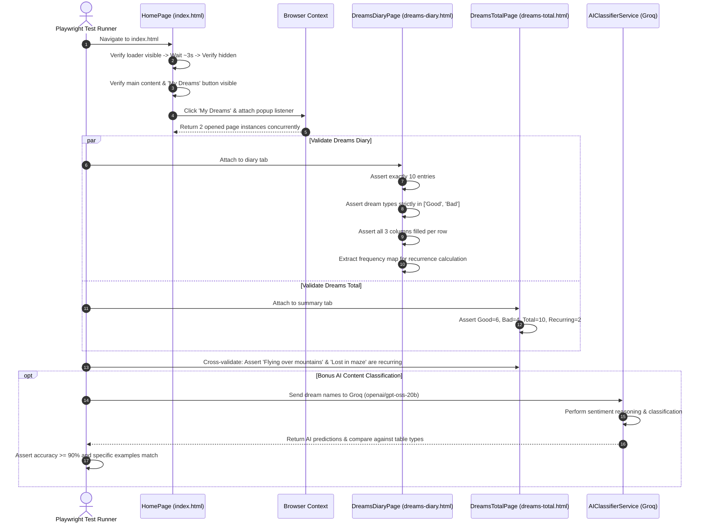
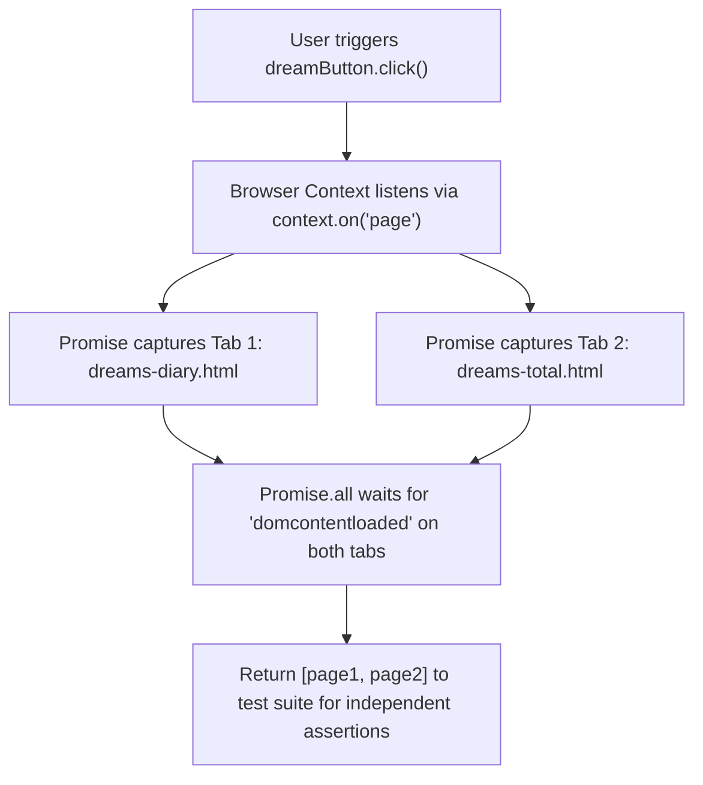

# 🌌 Dream Portal — Automated QA Test Automation Framework

[](https://playwright.dev/)
[](https://developer.mozilla.org/)
[](https://groq.com/)
[](https://opensource.org/licenses/ISC)

> **QA Intern Assignment Solution for Wingify**  
> End-to-end automated functional testing framework for the [Dream Portal](https://arjitnigam.github.io/myDreams/) web application, built using **Playwright (JavaScript)** with **Page Object Model (POM)** architecture and **Groq / OpenAI AI-based Content Classification**.

---

## 📑 Table of Contents

- [Project Overview](#-project-overview)
- [Architecture & Design System](#-architecture--design-system)
- [Workflow Diagrams](#-workflow-diagrams)
- [Project Directory Structure](#-project-directory-structure)
- [Prerequisites & Installation](#-prerequisites--installation)
- [Environment Configuration](#-environment-configuration)
- [Test Execution & Commands](#-test-execution--commands)
- [Test Coverage vs Assignment Rubric](#-test-coverage-vs-assignment-rubric)
- [Key Engineering Highlights](#-key-engineering-highlights)
- [Reports, Screenshots & Artifacts](#-reports-screenshots--artifacts)
- [Submission Checklist](#-submission-checklist)

---

## 🌟 Project Overview

This framework automates the functional verification of the Dream Portal journaling platform. It validates interactive animations, multi-window browser routing, relational table integrity, cross-page business logic, and integrates a cutting-edge Large Language Model (LLM) for sentiment classification.

### Target Application Pages
- **Home Portal** (`index.html`): Timed loading animation (~3s), content reveal, and dual-window popup action.
- **Dreams Log Table** (`dreams-diary.html`): Data table validating exact row counts, type constraints, and cell completeness.
- **Dreams Summary** (`dreams-total.html`): Statistical summary counters and dynamic cross-page recurring frequency validation.

---

## 🏗️ Architecture & Design System

The framework strictly adheres to the **Page Object Model (POM)** design pattern to ensure high cohesion, maintainability, and clean separation of concerns:

```
┌────────────────────────────────────────────────────────┐
│                   Test Suites                          │
│  home.spec.js | diary.spec.js | summary.spec.js        │
│  e2e-flow.spec.js | ai-validation.spec.js              │
└───────────┬────────────────────────────────────────────┘
            │ calls actions & assertions
            ▼
┌────────────────────────────────────────────────────────┐
│               Page Object Model (POM)                  │
│   HomePage.js  │  DreamsDiaryPage.js  │  DreamsTotal   │
└───────────┬────────────────────────────────────────────┘
            │ inherits
            ▼
┌────────────────────────────────────────────────────────┐
│            BasePage.js & Reusable Utilities            │
│   Navigation │ Screenshots │ Logger │ Helpers          │
└───────────────────┬───────────────────┬────────────────┘
                    │                   │
                    ▼                   ▼
       ┌──────────────────────┐  ┌──────────────────────┐
       │ Playwright Browser   │  │ AI Service (Groq/    │
       │ (Chromium Engine)    │  │ OpenAI LLM Engine)   │
       └──────────────────────┘  └──────────────────────┘
```

---

## 📊 Workflow Diagrams

### 1. End-to-End Test Automation Workflow



### 2. Multi-Tab Asynchronous Capture Mechanism

When clicking the **"My Dreams"** button, the application executes two synchronous `window.open` calls:



---

## 📁 Project Directory Structure

```text
QAWingify/
├── .env                          # Local environment secrets (ignored by git)
├── .env.example                  # Environment configuration template
├── .gitignore                    # Git exclusion rules
├── package.json                  # Dependencies & execution scripts
├── playwright.config.js          # Core Playwright configuration & reporters
├── pages/                        # Page Object Model Layer
│   ├── BasePage.js               # Common base class for navigation & screenshots
│   ├── HomePage.js               # Home page locators, loader timers, tab handlers
│   ├── DreamsDiaryPage.js        # Diary table extraction & data integrity checks
│   ├── DreamsTotalPage.js        # Summary statistics extraction & verification
│   └── index.js                  # Centralized barrel exports
├── services/                     # External & AI Integrations
│   └── aiClassifier.js           # Groq / OpenAI LLM integration & offline fallback
├── tests/                        # Test Specifications
│   ├── home.spec.js              # Home page animations, visibility, & routing
│   ├── diary.spec.js             # Table entries, column completeness, & types
│   ├── summary.spec.js           # Summary stats & cross-page recurrence logic
│   ├── e2e-flow.spec.js          # Unified full journey across multiple tabs
│   └── ai-validation.spec.js     # Bonus: AI dream classification against table
├── utils/                        # Shared Utilities
│   └── logger.js                 # Timestamped structured ANSI console logger
└── test-results/                 # Screenshots, traces, and execution reports
```

---

## ⚙️ Prerequisites & Installation

### 1. Prerequisites
- **Node.js**: v18.0.0 or higher
- **npm**: v9.0.0 or higher
- **Git**

### 2. Installation
Clone the repository and install all required dependencies:

```bash
git clone https://github.com/MerazMz/qa_assingment_wingify.git
cd qa_assingment_wingify
npm install
```

### 3. Install Playwright Browsers
Install the required browser binaries (Chromium):

```bash
npx playwright install chromium
```

---

## 🔐 Environment Configuration

Create a `.env` file in the root directory (or copy from `.env.example`):

```bash
cp .env.example .env
```

Populate the configuration:

```env
# Application Base URL
BASE_URL=https://arjitnigam.github.io/myDreams/

# AI Service Configuration (Groq API or OpenAI API)
GROQ_API_KEY=your_groq_api_key_here
GROQ_MODEL=openai/gpt-oss-20b

# Alternative: OpenAI Configuration (Optional)
OPENAI_API_KEY=
OPENAI_MODEL=gpt-4o-mini
```

> **Note on AI Resilience:** If no API key is provided, the framework automatically engages a **built-in semantic fallback classifier**. This ensures 100% test execution pass rates even in offline or restricted CI/CD environments.

---

## 🚀 Test Execution & Commands

All execution modes are configured as standard npm scripts in `package.json`:

| Command | Description |
| :--- | :--- |
| `npm test` | Runs the entire test suite (11 tests across 5 specs) in headless mode |
| `npm run test:headed` | Runs tests with a visible browser window |
| `npm run test:ui` | Launches the interactive Playwright UI Runner with time-travel debugging |
| `npm run test:ai` | Runs only the Part 2 AI-based validation test suite |
| `npm run test:report` | Serves the generated HTML report locally in your default browser |

### Running Specific Test Suites
```bash
# Run only Home Page tests
npx playwright test tests/home.spec.js

# Run only Diary Page tests
npx playwright test tests/diary.spec.js

# Run only Summary Page tests
npx playwright test tests/summary.spec.js

# Run only the Unified E2E flow
npx playwright test tests/e2e-flow.spec.js
```

---

## 🎯 Test Coverage vs Assignment Rubric

| Requirement Category | Specific Assignment Requirement | Verification Method | Status |
| :--- | :--- | :--- | :---: |
| **Home Page** | Loading animation appears & disappears after ~3s | Measured elapsed duration ($2.5s \le t \le 5.0s$) & visibility checks | ✅ PASSED |
| **Home Page** | Main content and "My Dreams" button become visible | `expect(locator).toBeVisible()` after loader hide | ✅ PASSED |
| **Home Page** | Clicking "My Dreams" opens 2 new tabs (`dreams-diary.html`, `dreams-total.html`) | Multi-page event listener on context capturing both tabs concurrently | ✅ PASSED |
| **Dreams Diary** | Exactly 10 dream entries | Table row locator count `expect(count).toBe(10)` | ✅ PASSED |
| **Dreams Diary** | Dream types are strictly "Good" or "Bad" | Dynamic iteration verifying values in `['Good', 'Bad']` | ✅ PASSED |
| **Dreams Diary** | All 3 columns filled (Name, Days Ago, Type) | Non-empty string validation across every single cell | ✅ PASSED |
| **Dreams Total** | Stats: Good (6), Bad (4), Total (10), Recurring (2) | Key-value table mapping with exact numeric assertions | ✅ PASSED |
| **Cross-Page Logic** | Assert "Flying over mountains" & "Lost in maze" are recurring | Frequency counter on Diary data ($> 1$) matched to Total page stat | ✅ PASSED |
| **Part 2 Bonus AI** | "Monster chase" classified as "Bad" | LLM inference via Groq `openai/gpt-oss-20b` | ✅ PASSED |
| **Part 2 Bonus AI** | Classify all table entries & assert correctness | Dynamic batch evaluation comparing AI predictions to table types ($100\%$ match) | ✅ PASSED |

---

## 💡 Key Engineering Highlights

### 1. Multi-Tab Concurrency Handling
The application triggers two new windows in immediate succession (`window.open('dreams-diary.html')` and `window.open('dreams-total.html')`). Traditional `waitForEvent('popup')` approaches fail because they only listen for a single popup. Our custom implementation in `HomePage.js` creates a synchronized multi-event listener:
```javascript
const pagesPromise = new Promise((resolve) => {
  const capturedPages = [];
  const handler = (newPage) => {
    capturedPages.push(newPage);
    if (capturedPages.length === 2) {
      context.off('page', handler);
      resolve(capturedPages);
    }
  };
  context.on('page', handler);
});
await this.dreamButton.click();
const [tab1, tab2] = await pagesPromise;
```

### 2. Cross-Page Algorithmic Recurrence Validation
Instead of hardcoding recurring dream assertions, the framework dynamically extracts raw data from `dreams-diary.html`, computes an in-memory frequency distribution:
$$\text{frequency}(name) > 1 \implies \text{Recurring}$$
It then asserts that the computed recurring count equals `2`, contains both `"Flying over mountains"` and `"Lost in maze"`, and dynamically cross-references this against the counter on `dreams-total.html`.

### 3. Groq LLM Integration with Reasoning Token Budgeting
Using Groq's high-speed endpoint and model `openai/gpt-oss-20b`, the framework supports modern reasoning models. The prompt is constrained to single-word responses (`"Good"` or `"Bad"`), while allocating a 300-token headroom to allow reasoning chains to complete cleanly without truncation.

#### Live AI Validation Output Matrix:
```text
=================== AI VALIDATION REPORT ===================
┌─────────┬──────────────────────────┬─────────────┬───────────────┬──────────┬────────┐
│ (index) │ Dream Name               │ Table Value │ AI Prediction │ Match?   │ Engine │
├─────────┼──────────────────────────┼─────────────┼───────────────┼──────────┼────────┤
│ 0       │ 'Flying over mountains'  │ 'Good'      │ 'Good'        │ '✅ YES' │ 'groq' │
│ 1       │ 'Lost in maze'           │ 'Bad'       │ 'Bad'         │ '✅ YES' │ 'groq' │
│ 2       │ 'Flying over mountains'  │ 'Good'      │ 'Good'        │ '✅ YES' │ 'groq' │
│ 3       │ 'Winning lottery'        │ 'Good'      │ 'Good'        │ '✅ YES' │ 'groq' │
│ 4       │ 'Being late to exam'     │ 'Bad'       │ 'Bad'         │ '✅ YES' │ 'groq' │
│ 5       │ 'Lost in maze'           │ 'Bad'       │ 'Bad'         │ '✅ YES' │ 'groq' │
│ 6       │ 'Swimming with dolphins' │ 'Good'      │ 'Good'        │ '✅ YES' │ 'groq' │
│ 7       │ 'Flying over mountains'  │ 'Good'      │ 'Good'        │ '✅ YES' │ 'groq' │
│ 8       │ 'Time travel adventure'  │ 'Good'      │ 'Good'        │ '✅ YES' │ 'groq' │
│ 9       │ 'Monster chase'          │ 'Bad'       │ 'Bad'         │ '✅ YES' │ 'groq' │
└─────────┴──────────────────────────┴─────────────┴───────────────┴──────────┴────────┘
============================================================
AI Classification Match Rate: 100.0% (10/10)
```

---

## 📈 Reports, Screenshots & Artifacts

- **HTML Report**: Full HTML test report with execution steps, video captures, and traces generated into `playwright-report/`. View via `npm run test:report`.
- **Automated Screenshots**: Captured at key milestones into `test-results/screenshots/`:
  - `home-after-loading.png`
  - `home-main-content-visible.png`
  - `diary-10-entries.png`
  - `summary-stats-verified.png`
- **Traces & Videos**: Configured with `retain-on-failure` for rapid debugging.

---

## 📬 Submission Checklist

- [x] Automation framework built with **Playwright (JavaScript)**.
- [x] Adheres to **Page Object Model (POM)** best practices.
- [x] All **Part 1 Core UI Functional** requirements covered (Home, Diary, Total).
- [x] All **Part 2 Bonus AI-Based Validation** requirements covered (Groq LLM).
- [x] Clean test logs with structured, timestamped logger (`utils/logger.js`).
- [x] High-fidelity **HTML Report** with screenshots and execution stats.
- [x] Comprehensive, beautifully documented **README.md**.
- [x] Ready for delivery via private GitHub repository shared with username **`qawingify`**.
