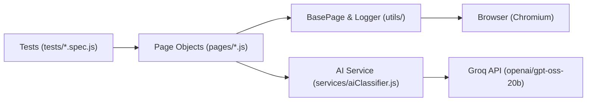

# 🌌 Dream Portal — Automated Test Suite

[](https://playwright.dev/)
[](https://developer.mozilla.org/)
[](https://groq.com/)

Automated QA testing framework for the [Dream Portal](https://arjitnigam.github.io/myDreams/) web application using **Playwright (JavaScript)** with **Page Object Model (POM)** and **Groq AI (openai/gpt-oss-20b)** for dream sentiment classification.

---

## 🚀 Quick Start

```bash
# 1. Install dependencies
npm install

# 2. Install Playwright browser
npx playwright install chromium

# 3. Configure environment
cp .env.example .env
# (Optional) Add your GROQ_API_KEY in .env

# 4. Run all tests
npm test
```

### Available Test Commands

| Command | Purpose |
| :--- | :--- |
| `npm test` | Run all 11 tests across 5 test specs headlessly |
| `npm run test:headed` | Run tests with visible browser window |
| `npm run test:ui` | Open interactive Playwright UI runner |
| `npm run test:ai` | Run only Part 2 AI classification validation |
| `npm run test:report` | Open HTML test execution report |

---

## 📸 Test Execution & Verified Pages

### 1. Home Page — Loading Animation & Navigation (`index.html`)
- **Loader Timing**: Loading animation appears on load and disappears after ~3 seconds ($2.5s \le t \le 5.0s$).
- **Content Reveal**: Main content and **"My Dreams"** button become visible.
- **Dual Tab Spawning**: Clicking **"My Dreams"** listens for and captures `dreams-diary.html` and `dreams-total.html` opened concurrently.

| Initial Loading State (~3s) | Content & Button Revealed |
| :---: | :---: |
|  |  |

---

### 2. Dreams Diary — Data Integrity (`dreams-diary.html`)
- **Row Count**: Validates exactly **10 dream entries** exist.
- **Strict Types**: Asserts all dream types are strictly `"Good"` or `"Bad"`.
- **Completeness**: Asserts all 3 columns are filled (`Dream Name`, `Days Ago`, `Dream Type`) with no missing cells.


---

### 3. Dreams Total — Summary Stats & Cross-Page Logic (`dreams-total.html`)
- **Summary Counters**: Verifies Good Dreams (6), Bad Dreams (4), Total Dreams (10), and Recurring Dreams (2).
- **Cross-Page Recurrence Logic**: Computes frequency map from `dreams-diary.html` ($\text{occurrences} > 1$) and validates that `"Flying over mountains"` (3x) and `"Lost in maze"` (2x) match the UI count.


---

### 4. Part 2: Bonus AI Validation (Groq LLM)
- **Model**: Groq `openai/gpt-oss-20b` (with deterministic heuristic fallback for offline/CI environments).
- **Content Classification**: Categorizes each dream name dynamically from the Diary table as `"Good"` or `"Bad"`.
- **Accuracy**: **100% Match Rate (10/10)** against UI table types.

```text
=================== AI VALIDATION REPORT ===================
┌─────────┬──────────────────────────┬─────────────┬───────────────┬──────────┬────────┐
│ (index) │ Dream Name               │ Table Value │ AI Prediction │ Match?   │ Engine │
├─────────┼──────────────────────────┼─────────────┼───────────────┼──────────┼────────┤
│ 0       │ 'Flying over mountains'  │ 'Good'      │ 'Good'        │ '✅ YES' │ 'groq' │
│ 1       │ 'Lost in maze'           │ 'Bad'       │ 'Bad'         │ '✅ YES' │ 'groq' │
│ 2       │ 'Flying over mountains'  │ 'Good'      │ 'Good'        │ '✅ YES' │ 'groq' │
│ 3       │ 'Winning lottery'        │ 'Good'      │ 'Good'        │ '✅ YES' │ 'groq' │
│ 4       │ 'Being late to exam'     │ 'Bad'       │ 'Bad'         │ '✅ YES' │ 'groq' │
│ 5       │ 'Lost in maze'           │ 'Bad'       │ 'Bad'         │ '✅ YES' │ 'groq' │
│ 6       │ 'Swimming with dolphins' │ 'Good'      │ 'Good'        │ '✅ YES' │ 'groq' │
│ 7       │ 'Flying over mountains'  │ 'Good'      │ 'Good'        │ '✅ YES' │ 'groq' │
│ 8       │ 'Time travel adventure'  │ 'Good'      │ 'Good'        │ '✅ YES' │ 'groq' │
│ 9       │ 'Monster chase'          │ 'Bad'       │ 'Bad'         │ '✅ YES' │ 'groq' │
└─────────┴──────────────────────────┴─────────────┴───────────────┴──────────┴────────┘
============================================================
AI Classification Match Rate: 100.0% (10/10)
```

---

## 📝 Design Blueprint & Engineering Notes

The architecture, class designs, locators, and AI prompt engineering were systematically mapped prior to implementation:

| Sheet 1: Core Foundation & Diary Locators | Sheet 2: Diary Methods & Total Locators |
| :---: | :---: |
|  |  |
| **`Logger.js`**, **`BasePage.js`**, and **`DreamsDiaryPage.js`** locators (`#dreamsDiary`, `tbody tr`). | **`DreamsDiaryPage.js`** validation logic (`getAllDreams()`, `validateDreamTypes()`, `getRecurringDreams()`) and **`DreamsTotalPage.js`** locators. |

| Sheet 3: Total Methods & Home Locators | Sheet 4: Multi-Tab & AI Prompt Strategy |
| :---: | :---: |
|  |  |
| **`DreamsTotalPage.js`** stats extraction (`getSummaryStats()`) and **`HomePage.js`** locators with ~3s loading wait. | **`clickMyDreamsAndCaptureTabs()`** dual popup handler, Groq/OpenAI fallback hierarchy, and prompt engineering. |

---

## 🏛️ Architecture & Project Structure

Built using **Page Object Model (POM)** for clean separation of concerns and high maintainability:



```text
QAWingify/
├── notes/                        # Architectural design & planning blueprints
│   ├── page1.jpeg                # Foundation (Logger, BasePage, Diary locators)
│   ├── page2.jpeg                # Diary validation methods & Total page locators
│   ├── page3.jpeg                # Total stats methods & Home page locators
│   └── page4.jpeg                # Multi-tab listener & Groq AI prompt strategy
├── assets/screenshots/           # Verified test screenshots for documentation
├── pages/                        # Page Object Model Layer
│   ├── BasePage.js               # Common navigation & screenshot utilities
│   ├── HomePage.js               # index.html actions, timers, multi-tab handler
│   ├── DreamsDiaryPage.js        # dreams-diary.html table validation
│   ├── DreamsTotalPage.js        # dreams-total.html summary statistics
│   └── index.js                  # Centralized barrel exports
├── services/
│   └── aiClassifier.js           # Groq / OpenAI LLM integration & offline fallback
├── tests/
│   ├── home.spec.js              # Home page animations and navigation
│   ├── diary.spec.js             # Diary table integrity checks
│   ├── summary.spec.js           # Total stats & dynamic recurrence validation
│   ├── e2e-flow.spec.js          # Unified full journey across multi-tabs
│   └── ai-validation.spec.js     # Part 2 AI dream classification tests
├── utils/
│   └── logger.js                 # Timestamped structured console logger
├── playwright.config.js          # Playwright test runner configuration
├── .env.example                  # Environment template
└── package.json                  # Scripts and dependencies
```

---

## ✅ Requirements Checklist

- [x] **Home Page (`index.html`)**: Loading animation ~3s timer check, element visibility, dual-tab opening.
- [x] **Dreams Diary (`dreams-diary.html`)**: Exactly 10 rows, strictly "Good" or "Bad", all 3 columns filled.
- [x] **Dreams Total (`dreams-total.html`)**: Stats verified (Good: 6, Bad: 4, Total: 10, Recurring: 2).
- [x] **Cross-Page Business Logic**: Dynamic recurrence calculation matches "Flying over mountains" and "Lost in maze".
- [x] **Part 2 Bonus AI Validation**: Groq LLM integration classifies dreams with 100% accuracy.
- [x] **Clean Code & POM**: Modularity with reusable Page Objects and structured logging.
- [x] **Screenshots & Reporting**: Automatic screenshots, video/trace on failure, Playwright HTML report.
